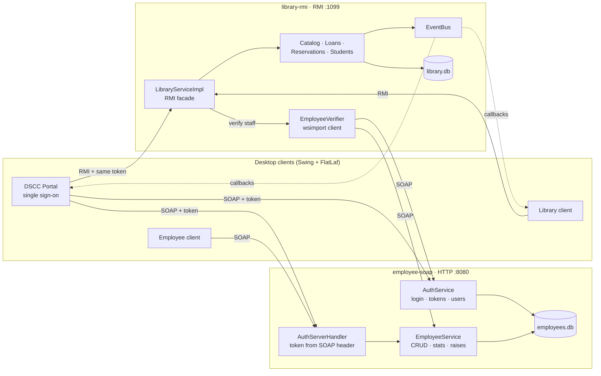

# DSCC-DIS: SOAP + RMI distributed information system

[](https://github.com/OWNER/dscc-dis/actions/workflows/ci.yml)


> [النسخة العربية](README.ar.md)

Two independent back-end systems that talk to each other, with one desktop portal on top:

- An **Employee system**: SOAP web services (JAX-WS) for employees, user accounts and login tokens.
- A **Library system**: Java RMI for books, students, loans, fines and reservations, with **real-time push to every open client** through RMI callbacks.
- A **Portal**: one sign-on for both. The library server checks every staff action by calling the Employee system over SOAP.

Built for the Distributed Systems course (Arab International University, Informatics & Communication Engineering). It started from the course assignment, then grew into a working multi-server application.

## What it demonstrates

| Topic | How it is done here |
|---|---|
| **Service integration** | The RMI server has no staff accounts of its own. It verifies every staff token with `AuthService.validateToken` and `EmployeeService.getEmployee`, using a SOAP client **generated from the WSDL with `wsimport`**. It shares no Java code with the SOAP project; the WSDL contract is enough. |
| **Authentication without changing the API** | The token travels in a **SOAP header**. A client handler adds it to every request. A server handler reads it and rejects the call with a SOAP Fault, so the required operation signatures stay unchanged. |
| **Push vs. polling** | RMI clients export a callback object and the server pushes events to it. SOAP is request/response only, so the employee clients poll `getActivitySince(lastId)`. |
| **Concurrency** | RMI and the HTTP server run each client on its own thread. All database work goes through one lock, and the SOAP check runs **before** the lock is taken, so a slow call never blocks other clients. |
| **Persistence and security** | SQLite with `PreparedStatement` everywhere. Passwords and PINs are hashed with salted PBKDF2-HMAC-SHA256, and old hashes are upgraded on the next login. Roles (ADMIN, LIBRARIAN, EMPLOYEE, STUDENT) are checked on the server. |
| **Business rules** | 14-day loans, at most 2 renewals, a fine of 500 per day late, no borrowing with an overdue book or unpaid fine, and a reservation queue: a returned copy is held for the first student waiting. |

## Architecture



| Module | Contents |
|---|---|
| [`dscc-common`](dscc-common) | Shared Swing components (tables, forms, charts, toasts), configuration, password hashing, the SOAP token handler |
| [`employee-soap`](employee-soap) | SOAP server (`employee.server.EmployeePublisher`) plus a full client and a simple client |
| [`library-rmi`](library-rmi) | RMI server (`library.server.LibraryServer`), clients, and the generated SOAP client in `library.integration.soap` |
| [`dscc-portal`](dscc-portal) | The single sign-on portal: dashboard, employees, payroll, library and reports |

## Quick start

Requirements: **JDK 17 or newer**. You don't need to install Maven: the Maven Wrapper downloads it on the first build.

```bash
# Windows: builds everything, starts both servers, then opens the portal
start-all.bat

# Linux / macOS
./start-all.sh
```

Or step by step:

```bash
./mvnw verify                 # build and run the tests  (Windows: mvnw.cmd verify)
./run.sh soap-server          # 1. Employee SOAP server   (Windows: run.bat ...)
./run.sh rmi-server           # 2. Library RMI server (it needs the SOAP server)
./run.sh portal               # 3. the portal
```

Other targets: `soap-client`, `rmi-client`, `soap-simple`, `rmi-simple`. Pass `--nogui` to a server to run it without its monitor window.

The databases are created on first start in `employee-soap/data` and `library-rmi/data`, filled with sample data. Delete those folders to reset.

### Demo accounts

| Role | Login | Can do |
|---|---|---|
| ADMIN | `admin` / `admin123` | Everything: employees, salaries, user accounts, library, reports |
| LIBRARIAN | `librarian` / `lib123` | Manage the library, plus the dashboard and library reports |
| EMPLOYEE | `employee` / `emp123` | Own profile; browse the catalog (read only) |
| STUDENT | `S1001` … `S1006` / PIN `1234` | Own loans, reservations and fines; reserve books |

These accounts are sample data for local demos only.

### Running on several machines

Set `soap.url` in [`config.properties`](config.properties) on the RMI server machine. Start the RMI server with that machine's IP (`run.bat rmi-server 192.168.1.10`). On each client, open **⚙ Servers…** on the login screen. Open ports 8080 (SOAP) and 1099 (RMI); live updates also need the server to be able to connect back to the client.

## Tests

`./mvnw verify` runs 42 tests, also on every push through GitHub Actions on Linux and Windows:

- **SOAP end to end**: the real endpoints with the real handler chain on a free port. Covers login, missing or expired tokens, and role checks (an EMPLOYEE can only read their own record).
- **RMI round trip**: registry lookup, remote calls, and a callback that the server calls back over RMI.
- **Library rules** on a fresh database: fines, renewal limit, borrowing blocked by fines, the reservation queue, and copy counts when books are updated or deleted.
- **Password hashing**, including the upgrade of old SHA-256 hashes.

## Regenerating the SOAP client

With the Employee SOAP server running:

```bash
./mvnw -pl library-rmi -am -Pwsimport compile      # -Dsoap.url=http://host:8080 for another server
```

## Tech stack

Java 17 · JAX-WS RI 2.3 (SOAP) · Java RMI · SQLite (sqlite-jdbc) · Swing + FlatLaf · JUnit 5 · Maven

## License

[MIT](LICENSE)
